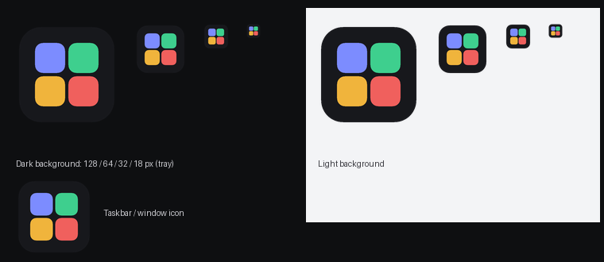

# BentoBay


**One native desktop bay for all your AI tools.** Stop juggling tabs, logins and subscriptions: BentoBay holds Claude, ChatGPT, Gemini and the rest in one window, and keeps an eye on your credits, spend and habits.



> App screenshots coming soon. Run it locally to see it.

## Highlights
- **One window, many tools.** Each tool runs in its own native browser view with its own saved login (not an iframe), kept warm so switching is instant. Split view puts two tools side by side.
- **Fast to drive.** Command palette, number-key jumps, rebindable shortcuts, a global summon hotkey, tray icon and launch at login.
- **Credits, plans and spend.** Credit bars, renewal countdowns, monthly spend totals, threshold alerts and a "limit rescue" that points you to a tool with room left.
- **Prompt library.** Save prompts once, send them to any tool.
- **Second accounts.** Duplicate a tool to use another login in a separate session.
- **Wrapped.** Spotify-style stats built from time counters only: total time, top tool, peak hour, streaks and an AI personality.
- **Healthy usage.** Optional daily limit, quiet hours and Manual Power sessions that pause AI so you think it through yourself. One master switch turns it all off.
- **Companion.** A small pet that reacts to your habits. Optional chat with your own Anthropic API key.
- **Auto-detect your tools (optional).** Sign in with Google and BentoBay reads subscription receipts to pre-select tools. Or skip it and choose by hand.

## Quick start
Requires [Node.js](https://nodejs.org) 20 or newer.
```
npm install
npm start          # run in development
npm run dist       # build installers for your OS
```

## Detecting your tools with Google (optional)
BentoBay scans Gmail receipts (last 120 days, read-only) from known AI vendors to pre-select tools, guess plans and estimate renewal dates.
1. Google Cloud Console: create a project and enable the **Gmail API**.
2. OAuth consent screen: add yourself as a test user. Create credentials: **OAuth client ID, Desktop app**.
3. Save `google-client.json` in the app data folder (or set `GOOGLE_CLIENT_ID` and `GOOGLE_CLIENT_SECRET`):
   `{ "client_id": "...", "client_secret": "..." }`
   Windows `%APPDATA%/BentoBay`, macOS `~/Library/Application Support/BentoBay`, Linux `~/.config/BentoBay`.

`gmail.readonly` is a restricted scope. A public release of your own client needs Google's security review; in test mode tokens expire every 7 days.

## Companion chat (optional, bring your own key)
Settings, Companion: turn on AI chat and paste your Anthropic API key. It is encrypted with the OS keychain, excluded from backups, and used only from the app's main process. Messages go to the Anthropic API only when you chat.

## Privacy
Everything is stored on your device. Usage stats are time counters per tool and hour, never page content. No telemetry.

## Security
Sandboxed tool views with separate sessions, a strict UI content security policy, permission prompts for mic and camera, http(s)-only loading, and keychain-encrypted secrets. Details and how to report an issue are in [SECURITY.md](SECURITY.md). No app is "fully secure": keep Electron updated (Dependabot is set up) and only import backups you trust.

## Known limits
- Credits and renewals are entered by you; detection only estimates renewals. No provider offers a public usage API for chat subscriptions.
- Google may refuse "Continue with Google" inside embedded views. Use that tool's email login instead.
- Time is counted for the active tool while BentoBay is focused. In split view the primary tool gets the time.
- Installers are not code-signed, so Windows and macOS will warn on first launch.
- Not affiliated with any listed service.

## Project layout
```
main.js         Electron main process (windows, views, tray, shortcuts)
preload.js      Safe bridge between UI and main process
src/            Google sign-in, Gmail scanner, tool catalog
renderer/       UI: core.js (state), pages.js (screens), app.js (events)
.github/        CI and release workflows
```

## Contributing and releases
See [CONTRIBUTING.md](CONTRIBUTING.md). To publish installers, tag a version (`git tag v0.3.1 && git push --tags`); the Release workflow builds Windows, macOS and Linux and attaches them to a GitHub release.

## License
MIT, see [LICENSE](LICENSE).
